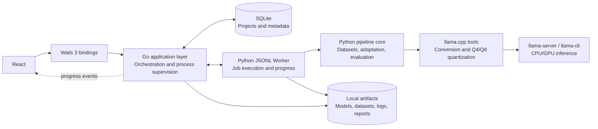
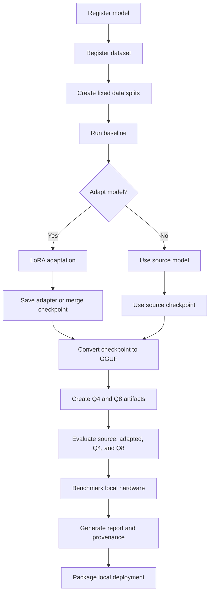

# Local Model Research Workbench

A research prototype for measuring, adapting, and deploying small open-weight
models under real-world constraints.

The immediate goal is not to build a complete enterprise MLOps platform. It is
to build one reliable, reproducible research workflow and use it to study
whether local models can be trusted for specific tasks.

**Current case study:** wound-infection triage from photographs.

## Technology stack

### Desktop application

- **Wails 3** for the desktop shell;
- **Go** for application orchestration, process supervision, filesystem
  access, local storage, and communication with the pipeline; and
- **React with TypeScript** for the user interface.

### User interface

- **Tailwind CSS** for styling; and
- **Redux** for application state, including projects, models, datasets,
  experiments, jobs, progress, logs, artifacts, and reports.

### Model pipeline

- **Python** for data preparation, inference, adaptation, evaluation, and
  benchmarking;
- a **JSONL worker** for communication with the Go application;
- **PyTorch, Transformers, Datasets, PEFT, and Accelerate** for model
  adaptation; and
- **llama.cpp** for checkpoint conversion, local inference, benchmarking, and
  creating Q4/Q8 model artifacts.

The React interface communicates with Go through typed Wails bindings and
events. Go starts and supervises the Python JSONL worker, sends job manifests,
and translates worker events into application events. The interface does not
communicate directly with Python.

### Model formats

The pipeline uses different formats for different stages:

| Stage | Format | Purpose |
| --- | --- | --- |
| Adaptation | Hugging Face checkpoint | Training and LoRA/QLoRA |
| Adaptation output | LoRA adapter or merged checkpoint | Reproducible model update |
| Deployment source | GGUF | llama.cpp conversion and inference |
| Deployment variants | Q8 and Q4 GGUF | Local CPU/GPU deployment |

GGUF is the deployment format, not the primary fine-tuning format.

## Architecture

### Application architecture



The application is local-first. Go is the desktop-facing boundary and process
supervisor. The Python worker performs model operations, while large model
files, datasets, logs, and reports remain on the local filesystem.

### Research workflow



## Project structure

```text
project/
├── ml_workbench/   # Wails, Go orchestration, and React interface
├── pipeline/       # Python core and JSONL worker
├── configs/        # Reproducible experiment configurations
├── artifacts/      # Checkpoints, adapters, GGUF files, logs, and reports
├── tests/           # Go, Python, and UI tests
└── README.md
```

The desktop application owns the user experience and job lifecycle. The
pipeline owns model operations. Configurations describe experiments, while
artifacts contain their outputs.

## Why this project exists

Downloading an open-weight model does not give an organization dependable,
domain-specific intelligence. The model still needs to be:

- tested on relevant data;
- adapted to the target task;
- compared against a baseline;
- evaluated for reliability and subgroup failures;
- measured on the hardware where it will run; and
- tracked so that results can be reproduced.

This project provides a local-first workflow for answering those questions
while keeping models and data under the researcher's control.

## Thesis case study

The first research profile is **wound-infection triage from photographs**. The
thesis investigates whether a small vision-language model can remain reliable
when adapted and compressed for offline use.

The study examines:

- zero-shot and task-adapted performance;
- sensitivity, specificity, calibration, and consistency;
- errors by wound source, image quality, and estimated skin tone;
- the effect of 8-bit and 4-bit quantization; and
- latency, memory, thermal behavior, and network isolation on local hardware.

The wound-care profile is the first serious case study, not the final boundary
of the workbench. After the capstone, another researcher should be able to
reuse the workflow for a similar local-model study by providing a dataset
adapter, task definition, metrics, and optional subgroup dimensions.

## Core workflow

1. **Register a model**  
   Record the model family, files, architecture, quantization, license,
   checksums, and runtime configuration.

2. **Register a dataset**  
   Validate its structure, define label mappings, create fixed
   train/validation/test splits, and track dataset versions.

3. **Run a baseline**  
   Use a frozen prompt and configuration to establish initial performance.

4. **Adapt the model**  
   Use a Hugging Face checkpoint with parameter-efficient fine-tuning such as
   LoRA. Keep the adapter and training configuration as versioned artifacts.

5. **Convert the model**  
   Convert the source or adapted Hugging Face checkpoint to GGUF with the
   matching llama.cpp conversion tool.

6. **Quantize the model**  
   Create **Q4** and **Q8** GGUF artifacts. Record the quantization tool,
   format, settings, source artifact, and output checksum.

7. **Evaluate and compare**  
   Compare the source, adapted, **Q4**, and **Q8** variants using task metrics,
   calibration, subgroup analysis, error coverage, and paired predictions.

8. **Benchmark locally**  
   Measure latency, throughput, memory, temperature, and outbound network
   traffic on the target device.

9. **Package the result**  
   Export the model, configuration, evaluation report, and complete provenance
   so another researcher can reproduce or extend the experiment.

## Capstone MVP

The capstone focuses on one supported vision-language model family and one
complete, reproducible path through the workflow:

- model and dataset registration;
- local baseline inference;
- experiment configuration and logging;
- LoRA-based adaptation;
- Hugging Face-to-GGUF conversion;
- Q4 and Q8 model quantization;
- comparison of the source, adapted, Q4, and Q8 models;
- evaluation and hardware benchmarking; and
- provenance-rich reports and a local deployment configuration.

The initial quantization scope is deliberately limited to producing **Q4** and
**Q8** models. For the current llama.cpp workflow, these correspond to formats
such as `Q4_K_M` and `Q8_0`. Other quantization methods and formats will be
added later.

Supporting every model architecture, multi-user governance, automatic feedback
loops, and production medical deployment are also future extensions. Feedback
must be reviewed and approved before it becomes training or evaluation data.

## Current state

The repository contains a Go-managed Python JSONL pipeline with implementations
for dataset registration, baseline inference, LoRA adaptation orchestration,
GGUF conversion, Q4/Q8 quantization, evaluation, and hardware benchmarking.
The desktop UI and SQLite experiment registry are still pending.

The pipeline should not be used to present smoke-test outputs as final thesis
results. Every reported result must include its model, dataset split, prompt,
runtime, hardware, code revision, and configuration.

The intended end state is a reusable research instrument: a researcher should
be able to run an experiment, understand where a model succeeds and fails,
compare model variants, and export enough evidence for another person to
reproduce the work.

## Design principles

- **Local-first:** models and data can remain on the user's infrastructure.
- **Clear boundaries:** React handles presentation, Redux handles application
  state, Go orchestrates the desktop application, and Python performs model
  work.
- **Evidence over claims:** no model is considered improved without a fixed,
  reproducible comparison.
- **Provenance by default:** every result links back to its model, data,
  configuration, code, and hardware.
- **Safety-aware evaluation:** false negatives, calibration, coverage, and
  subgroup failures matter alongside aggregate accuracy.
- **Reproducibility:** experiments use versioned inputs, fixed splits, explicit
  settings, and exportable reports.

This is a research prototype and is not a medical device or a substitute for
clinical judgment.


The architecture is established, but it is not yet a working end-to-end app. The remaining MVP work is:

1. **Implement the pipeline stages**
   - Dataset registration and validation
   - Frozen baseline inference through `llama-server`
   - LoRA/QLoRA adaptation
   - Adapter merging
   - Hugging Face → GGUF conversion
   - Q4/Q8 quantization
   - Evaluation and paired comparisons
   - Hardware benchmarking
   - Report and deployment packaging

2. **Complete the worker contract**
   - Persistent worker lifecycle
   - Job cancellation and process cleanup
   - Restart/recovery for interrupted jobs
   - Structured progress, logs, artifacts, and errors
   - Worker and manifest validation

3. **Build the Go application layer**
   - Replace the demo service with model, dataset, experiment, and report services
   - Connect SQLite persistence
   - Manage llama.cpp and Python processes
   - Stream worker events to Wails
   - Resolve and validate application paths

4. **Build the React/Redux UI**
   - Models: register, inspect, and select
   - Datasets: upload, validate, and view splits
   - Experiments: configure baseline, adaptation, and quantization
   - Jobs: show progress, logs, and cancellation
   - Results: metrics, comparisons, subgroup results, and hardware measurements
   - Reports and export
   - Replace the generated greeting screen

5. **Set up llama.cpp**
   - Build or bundle `llama-server`, `llama-cli`, conversion tools, and `llama-quantize`
   - Support CPU and explicit GPU backend selection
   - Record runtime version and hardware configuration
   - Verify Qwen-VL conversion and projector compatibility

6. **Add minimum storage and provenance**
   - SQLite tables for models, datasets, experiments, jobs, and artifacts
   - Immutable dataset splits
   - Checksums and configuration snapshots
   - Reproducible export manifests

7. **Package and test**
   - Bundle Python and dependencies
   - Bundle llama.cpp executables and required libraries
   - Add CI or automated tests
   - Test clean-machine installation
   - Test a complete baseline → adapt → convert → Q4/Q8 → evaluate run

The next priority should be one complete workflow using the existing Qwen model and SurgWound data. Everything else should wait until that path works reliably.


```bash
  WEBKIT_DISABLE_COMPOSITING_MODE=1 LIBGL_ALWAYS_SOFTWARE=1 wails3 dev
```